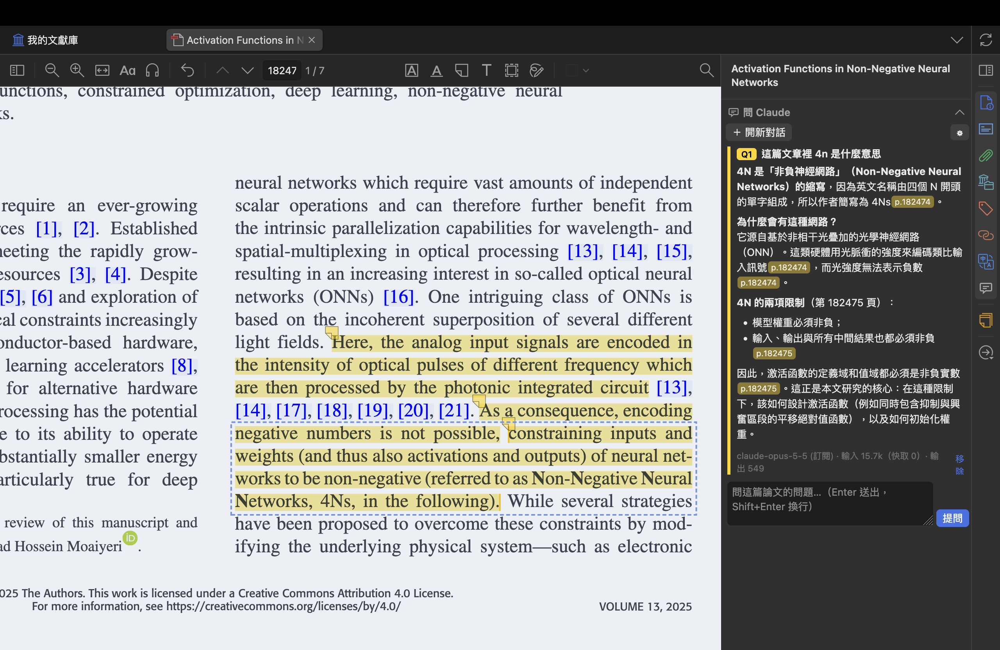

# Installing Paper Chat (Windows / macOS)

**English** ｜ [繁體中文](paper-chat-install.zh-TW.md)

Paper Chat is a Zotero plugin: open a PDF and ask Claude about it in the right-hand pane. Every passage the answer quotes is highlighted in the PDF, and clicking `p.N` in the answer jumps there.



<sub>Example paper: M. Becker, D. Drees, F. Brückerhoff-Plückelmann, C. Schuck, W. Pernice, B. Risse, “Activation Functions in Non-Negative Neural Networks,” *IEEE Access* 13 (2025), [doi:10.1109/ACCESS.2025.3622408](https://doi.org/10.1109/ACCESS.2025.3622408), licensed under [CC BY 4.0](https://creativecommons.org/licenses/by/4.0/). Screenshot of the paper's PDF in Zotero, cropped, with highlights added by Paper Chat.</sub>

Three steps, about 10 minutes:

1. [Install Zotero](#1-install-zotero)
2. [Choose how to reach Claude](#2-choose-how-to-reach-claude): Claude Code (your subscription) or an API key (pay as you go)
3. [Download and install Paper Chat](#3-download-and-install-paper-chat)

---

## 1. Install Zotero

Skip this if you have Zotero 7 or later. (To check: Help → About Zotero; on macOS, Zotero → About Zotero.)

Download it from <https://www.zotero.org/download/> and install with the default options, on Windows and macOS alike.

---

## 2. Choose how to reach Claude

| | A. Claude Code (subscription) | B. Anthropic API key |
|---|---|---|
| Cost | Counts against your Claude Pro/Max plan; nothing extra | Pay per use; each answer shows its token count |
| You need | A paid Claude subscription | Credit on the Anthropic developer platform |
| Citation positions | The plugin finds the sentences Claude quotes in the paper's text; the odd one it can't find shows as `[n]` | The API returns exact positions |

**If you have Pro or Max, choose A.** You can set up both; Claude Code is used first by default.

### A. Install Claude Code

If you already use Claude Code, just make sure it's logged in and skip to [step 3](#3-download-and-install-paper-chat).

#### Windows

> ⚠️ Paper Chat hasn't been tested on a real Windows machine yet. If something goes wrong, please [open an issue](https://github.com/nebula0/zotero-llm-wiki/issues) with the error shown in the pane.

1. **Install Git for Windows first**: <https://git-scm.com/downloads/win>, keeping all default options. Claude Code needs it on Windows.
2. Press the Start key, search for "PowerShell" and open it.
3. Paste this line, press Enter and wait for the install to finish:
   ```
   irm https://claude.ai/install.ps1 | iex
   ```
4. Type `claude`, press Enter, and follow the prompts to log in to your Claude account.
5. When you reach the input prompt, the login worked. Type `/exit` and close PowerShell.

#### macOS

1. Press `Cmd+Space`, type "Terminal" and open it.
2. Paste this line, press Enter and wait for the install to finish:
   ```
   curl -fsSL https://claude.ai/install.sh | bash
   ```
3. Type `claude`, press Enter, and follow the prompts to log in to your Claude account. (If it says `command not found`, close Terminal, open a new window and try again.)
4. When you reach the input prompt, the login worked. Type `/exit` and close Terminal.

> If Zotero was already open while you installed Claude Code, **quit Zotero completely and reopen it** so the plugin can find Claude Code.

### B. Create an Anthropic API key

1. Sign in at <https://platform.claude.com/settings/keys> (create an account if needed) and add credit under Billing.
2. Click **Create Key**, give it a name (e.g. `paper-chat`), and copy the key (it starts with `sk-ant-`).
3. Keep it handy; you'll paste it into the plugin's settings after step 3.

> 🔑 An API key is a password, and it spends your credit. Paste it only into Paper Chat's settings field. Paper Chat keeps it in Zotero's password manager, not in the prefs file.

---

## 3. Download and install Paper Chat

1. Download **[paper-chat.xpi](https://github.com/nebula0/zotero-llm-wiki/releases/latest/download/paper-chat.xpi)**.
   - **Chrome or Edge** is easiest.
   - **Safari** may unzip it into a folder, which won't install. Download it with Chrome instead.
   - **Firefox** thinks it's a Firefox extension and offers to install it. Right-click the link → "Save Link As…" instead.
2. Open Zotero and choose **Tools → Plugins** from the menu bar.
3. Click the **gear** at the top right → **Install Plugin From File…**, and pick the `paper-chat.xpi` you downloaded.
4. When **Paper Chat** appears in the list, it's installed. No restart needed.

### First use

1. In Zotero, double-click an item with a PDF to open it.
2. An **"Ask Claude"** section appears at the bottom of the right-hand pane.
   **Click the chat bubble in the strip of icons on the far right** to pin it to the top of the pane; Zotero remembers this.
3. If you chose B (API key): click **⚙︎** in the section, paste the key into "Anthropic API key" and click "Save".
   If you chose A (Claude Code): there's usually nothing to set; just ask.
4. Type a question in the box at the bottom and press Enter (Shift+Enter for a new line).

The first question takes longer because the plugin reads the whole PDF's text first; later questions on the same paper are faster.

---

## Using it

- **Each question has its own color**: Q1 yellow, Q2 blue, Q3 green… The passages an answer quotes are highlighted in that color, with the comment "Q1: your question".
- **Click `p.N` in an answer**: the PDF scrolls to that page and selects the highlight. Hover over it to see the quoted sentence.
- **Ask about a selection**: select text in the PDF and click "Ask Claude" in the popup; the text is quoted into the input box.
- **Follow-ups**: questions in the same conversation carry the earlier Q&A. Click "+ New conversation" to start over.
- **Remove a question**: click "Remove" under it to delete its highlights and drop it from the note and the pane.
- **The Q&A note**: an "AI Q&A" child note is created under the item, with page links that jump into the PDF. It is rewritten with every question, so **don't write your own notes in it**.

### Settings (⚙︎)

| Field | What it does |
|---|---|
| Use | Automatic (Claude Code if installed, otherwise the API key) / Claude Code only / API key only |
| Account | Which Claude Code account to use, if you have several (`~/.claude`, `~/.claude-work`…) |
| Model | Separate model choices for Claude Code and the API |
| Path to claude | Usually found automatically; fill in only if it isn't |
| Effort | `low` to `max`, default `medium`. Higher is more thorough, slower and uses more quota |
| Keep a note of the Q&A under the item | Untick it if you don't want the note under the item |

---

## FAQ

**Q: The pane says "Claude Code was not found" or asks you to set up Claude Code or an API key.**
Make sure Claude Code is installed, then **quit Zotero completely and reopen it**. If it still isn't found, look up its path and paste it into ⚙︎ → "Path to claude":
- Windows: run `where.exe claude` in PowerShell
- macOS: run `which claude` in Terminal (usually `/Users/<you>/.local/bin/claude`)

**Q: The pane says Claude Code isn't logged in for this account.**
Run `claude` in PowerShell (Windows) or Terminal (macOS) and log in. If you have several accounts, check that ⚙︎ → "Account" is the one you logged in to.

**Q: (Windows) The pane says Claude Code needs Git for Windows.**
Install it from <https://git-scm.com/downloads/win> (default options), then quit Zotero completely and reopen it.

**Q: The pane says your usage limit was reached.**
Your Claude plan's quota is used up for now. Wait for it to reset, or switch to an API key in ⚙︎. Paper Chat reads the whole paper for every question (often 20–40k tokens), so a Pro plan runs down faster.

**Q: The pane says the PDF has no text layer.**
It's a scan. Run OCR on it first (e.g. with Adobe Acrobat or macOS Preview), then add it to Zotero again.

**Q: Some citations in an answer show as `[n]` instead of `p.N`.**
The sentence Claude quoted couldn't be found in the PDF text (it spans pages, or a few words were miscopied), so it can't be highlighted. Hover over `[n]` to see what Claude quoted.

**Q: No highlights appear in a group library.**
You can't edit that group, so Paper Chat can't add annotations; the answer still shows in the pane.

**Q: How do I update?**
Zotero checks for plugin updates on its own. To update by hand, download the new `paper-chat.xpi` and install it as in [step 3](#3-download-and-install-paper-chat); your past Q&A is kept.

**Q: How do I uninstall?**
Tools → Plugins → the "…" next to Paper Chat → Remove. Existing highlights and notes stay; to delete them too, click the `paper-chat` tag in Zotero's tag selector (bottom left) to find them.

**Q: Where does my paper go?**
The PDF's **text** is sent to Anthropic, either way; figures are not. Don't use it on documents that must not leave your computer. The full conversation shown in the pane stays on your computer, in `<Zotero data folder>/paper-chat/`.

For more (how it works, where data is stored, development), see the [Paper Chat guide](../zotero-addon/README.md).
